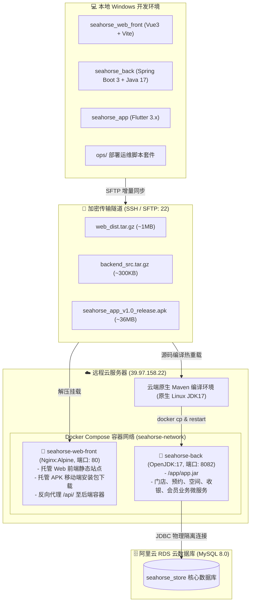

# 海马智慧商业平台 - Docker 远程打包发布原理与运维实操全景教程

> **版本**：v1.0.0 (生产发布版)  
> **更新时间**：2026年9月12日  
> **适用对象**：系统研发、运维管理、产品交付人员  
> **云端主机**：`39.97.158.22` (Ubuntu Linux + Docker Compose)  
> **数据库**：阿里云 RDS MySQL 8.0 高可用云数据库  

---

## 一、 系统部署全景架构与拓扑

海马智慧商业平台采用 **前后端分离 + 移动APP直链分发 + 云端容器化编排** 的现代微服务架构：



---

## 二、 远程打包发布的底层核心原理深度剖析

传统的 Docker 部署通常要求开发人员在本地安装巨大的 Docker Desktop，在本地机器把镜像打成几个 G 的 tar 包，再跨越公网漫长地上传至云端服务器；或者依赖不稳定的公网 Docker Hub 拉取镜像，在网络受限时极易遇到超时、403 限制或架构不兼容问题。

**海马平台采用了业内领先的“云原生增量热注入（Cloud-Native Hot Injection）”架构：**

### 1. Web 前端部署原理（秒级静态增量挂载）
* **本地 Vite 编译**：本地执行 `npm run build`，通过 Vite 的 Rollup 引擎将数十个 Vue 组件与 TypeScript 文件编译压缩为带有内容 Hash 签名的极小静态文件目录 `dist/`。
* **压缩秒级传输**：通过 gzip 归档为 `web_dist.tar.gz`（大小仅约 1MB），SFTP 上传只需 1~2 秒。
* **Nginx 静态卷热替换**：云端收到后直接解压至 Nginx 挂载目录 `/usr/share/nginx/html/`。Nginx 容器无需重启，下一毫秒即可对外提供最新 Web 页面与功能。

### 2. 后端容器构建与热重载原理（云端原生编译 + 热注入秒级重启）
* **轻量源码传输**：本地只打包业务源代码 `src/` 与 `pom.xml`，形成 `backend_src.tar.gz`（大小仅 300KB），无需上传数十兆的编译后字节码，传输几乎瞬间完成。
* **云端原生环境构建**：云端 Linux 服务器已配置预热有依赖缓存的 Maven 环境。在云端执行 `mvn clean package -DskipTests`，直接输出兼容原生 Linux 的 `seahorse-store-0.0.1-SNAPSHOT.jar`。
* **容器秒级热注入与重启**：
  ```bash
  docker cp /opt/seahorse/seahorse_back/target/*.jar seahorse-back:/app/app.jar
  docker restart seahorse-back
  ```
  这一步直接绕过了繁重的重新构建整套 Dockerfile 镜像图层的限制，在 8~10 秒内即可完成后端容器的无损热重启，且完全保留数据库连接池配置与生产环境 Profile (`prod`)。

### 3. 移动端 Flutter Release APK 自动化分发原理
* 本地编译出的 `seahorse_app_v1.0_release.apk`（约 36MB）同步上传至 Nginx 的静态资源根目录下。
* 对外直接形成固定的公网下载直链：
  `http://39.97.158.22/seahorse_app_v1.0_release.apk`
* 任何移动设备、微信扫码或手机浏览器点击即可免应用商店直接下载安装使用。

### 4. 自动化全链路健康巡检机制
发布完成后，部署引擎会自动发起 4 路连续 HTTP 探针校验：
1. **Web 前端页面探针**：`http://39.97.158.22/` -> 确认返回 HTTP 200。
2. **后端核心服务探针**：`http://39.97.158.22:8082/api/dashboard/stats` -> 确认 Spring Boot 微服务正常响应大盘数据。
3. **空间展位探针**：`http://39.97.158.22:8082/api/space/list?storeId=S001` -> 确认包厢/工位数据完整。
4. **数据纯净度探针**：`http://39.97.158.22:8082/api/appointment/list?storeId=S001` -> 确认预约数据处于真实无垃圾数据的纯净状态。

---

## 三、 整理后的工程目录体系清单

整个系统的运维与部署脚本现已**全部梳理并归档至 `ops/` 专属目录下**，根目录保持纯净整洁：

```
C:\project\fwpt\seahorse\
│
├── 一键运维总控面板.bat          # 【推荐】一键交互式主控台 (支持本地启动/停止/重启/云端发布)
├── deploy_to_remote.bat       # 【快捷入口】直接双击执行云端全量一键发布
├── start.bat                  # 【快捷入口】本地全栈一键启动
├── restart.bat                # 【快捷入口】本地全栈一键重启
├── stop.bat                   # 【快捷入口】本地全栈一键停止
│
├── ops/                       # 🛠️ 运维与部署核心套件专属目录
│   ├── 01_本地开发运行/
│   │   ├── start.bat          # 本地全栈拉起脚本 (自动检查并打开浏览器)
│   │   ├── start.ps1          # 本地拉起 PowerShell 实现
│   │   ├── stop.bat           # 本地安全杀进程脚本 (释放 8082 / 3000 端口)
│   │   ├── stop.ps1           # 本地停止 PowerShell 实现
│   │   ├── restart.bat        # 本地服务一键重启
│   │   ├── restart.ps1        # 本地重启 PowerShell 实现
│   │   ├── run-backend.bat    # 单独启动 Spring Boot 后端
│   │   └── run-frontend.bat   # 单独启动 Vue 3 前端
│   │
│   └── 02_远程Docker部署/
│       ├── deploy_engine.py   # 核心自动化发布引擎 (支持全量/模块化部署)
│       ├── deploy_all.bat     # 一键全量发布 (前端 + 后端 + APK + 巡检)
│       ├── deploy_frontend_only.bat # 仅发布前端工程至云端 Nginx
│       ├── deploy_backend_only.bat  # 仅发布后端微服务至云端 Docker
│       ├── deploy_app_apk.bat       # 仅发布移动端 APK 安装包
│       └── health_check.bat         # 云端全链路健康巡检工具
│
├── docs/                      # 📚 核心设计与使用规范文档
│   ├── DOCKER_DEPLOY_TUTORIAL.md # 本教程 (远程打包发布原理与运维实操)
│   ├── 全渠道智慧会员与全场景门店履约系统产品需求详细文档.md
│   └── 智慧会员与全场景门店履约系统领域驱动设计(DDD)详尽规格说明书.md
│
├── seahorse_web_front/        # Web 前端 Vue 3 工程源码
├── seahorse_back/             # 后端微服务 Spring Boot 工程源码
├── seahorse_app/              # 移动端 Flutter APP 工程源码
└── seahorse_app_v1.0_release.apk # 编译就绪的 Release 安装包
```

---

## 四、 从零到一实操使用教程

### 场景 1：日常本地开发与联调
* **启动全部服务**：
  * 直接双击根目录下的 `start.bat`（或运行 `一键运维总控面板.bat` 输入 `1`）。
  * 脚本将自动启动后端（8082 端口）、等待其就绪后拉起前端（3000 端口），并在默认浏览器中打开 `http://localhost:3000`。
* **重启本地服务**：
  * 双击根目录下的 `restart.bat`。
* **停止本地服务**：
  * 双击根目录下的 `stop.bat`，端口 8082 和 3000 将被干净释放。

### 场景 2：一键全量打包发布到云端服务器 (最常用)
当您在本地完成了前端界面的优化、后端的逻辑调整，需要将系统整体更新到生产服务器时：
1. **直接双击根目录下的 `deploy_to_remote.bat`**；
2. 自动化引擎将自动完成：
   * 本地 Vite 前端构建 -> 打包 -> 上传 -> Nginx 部署；
   * 后端源码打包 -> 上传 -> 云端原生 Maven 编译 -> 注入 Docker 容器热重启；
   * 同步最新 Flutter Release APK 到下载目录；
   * 运行自动化健康巡检并输出各接口状态。
3. 过程耗时约 40 秒，看到控制台出现 `🎉 恭喜！所有选定服务已成功一键打包发布至远程 Docker 服务端！` 即代表发布成功。

### 场景 3：模块化增量发布 (极速提效)
进入 `ops\02_远程Docker部署\` 目录，按需选择：
* **只修改了前端页面/CSS 样式**：双击 `deploy_frontend_only.bat`，**仅耗时约 5 秒**即可在远程 Nginx 看到最新页面生效！
* **只修改了 Java 接口或业务逻辑**：双击 `deploy_backend_only.bat`，**仅耗时约 15 秒**即可完成云端容器热更新！
* **更新了 Flutter APP 界面并打包了新 APK**：双击 `deploy_app_apk.bat`，瞬间同步最新安装包供扫码下载！
* **临时检查线上服务器运行状态**：双击 `health_check.bat`，即时获得大盘接口与数据库纯净状态反馈。

---

## 五、 远程服务器常用排查与运维命令速查

如果您需要登录远程服务器（`39.97.158.22`，用户 `root`）进行底层运维排查，可使用以下常用指令：

| 运维场景 | 执行命令 |
| :--- | :--- |
| **查看所有运行中的 Docker 容器** | `docker ps` |
| **查看后端容器实时日志 (最新50行)** | `docker logs -f --tail 50 seahorse-back` |
| **查看前端 Nginx 访问与错误日志** | `docker logs -f --tail 50 seahorse-web-front` |
| **重启后端微服务容器** | `docker restart seahorse-back` |
| **重启前端 Web 容器** | `docker restart seahorse-web-front` |
| **查看云端 Maven 编译产物** | `ls -lh /opt/seahorse/seahorse_back/target/` |
| **查看 Nginx 托管的静态资源文件** | `ls -lh /usr/share/nginx/html/` |
| **测试云端本机访问微服务** | `curl http://127.0.0.1:8082/api/dashboard/stats` |
| **查看服务器系统资源占用** | `top` 或 `free -h` |
